 

---

## Sound familiar?

- Your team lives in spreadsheets and WhatsApp threads.
- Customers complain before you know something is down.
- The same repetitive tasks eat hours every week.

**I fix exactly that.** I run network operations at a live fiber ISP in Kenya, so I build software the way operators need it: reliable, simple, and ready for real customers on day one.

---

## Proof, not promises

| **2,000+** | **24/7** | **{2.5+ hrs}** |
|:---:|:---:|:---:|
| customers on networks I help run | live operations, not demos | manual work removed by automation |

---

## What I build

**Business software** · POS, inventory, billing, internal tools
**Network & infrastructure** · ISP-grade MikroTik, Linux, monitoring, fault response
**Automation & AI** · support agents, alerts, reporting, data pipelines

## Selected work

| Project | What it solves |
|---|---|
| **[SmartPOS](https://github.com/minion23k/inventory-management)** | Sales, stock, and access control in one platform |
| **Outage tracker** | Live fiber outage tracking with shift digests for ops |
| **AI support agent** | Customer self-service over WhatsApp and web |
| **Quant research** | Backtested, risk-managed trading systems |

## Live sites

| Site | My role | What it is | Status |
|---|---|---|---|
| **[billmart.pro](https://www.billmart.pro/)** | Built it | Marketing site for a fiber ISP in Machakos: plans and pricing, coverage check, wholesale and business pages, FAQ, and a route into the customer portal. Built on Next.js. |  |
| **[zafronixsafari.com](https://zafronixsafari.com/)** | Infrastructure and deployment | Safari tour operator's site (design by Innovition Solutions). I deployed it to production, set up the company's business email, and manage the server it runs on. |  |
| **[zayregadgets.com](https://zayregadgets.com/)** | Built it | Online gadgets business website. | |

Only public, non-NDA work is listed here. Client details stay private.

---

## Let's talk

Got a system that's slow, manual, or breaking? Tell me the problem. I reply with a plan, not a pitch.

**vincentkyalo23@gmail.com** · [@minion23k on X](https://x.com/minion23k)

Simplicity is not the absence of complexity. It is the result of understanding it.

